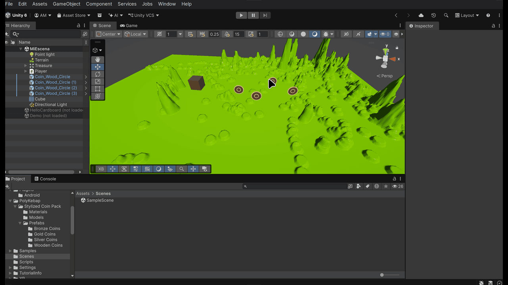

# Práctica 5

APKs: `./APKs/hello_cardboard.apk`, `./APKs/escena.apk`  
En el GitHub están en Releases, por su tamaño.  
Scripts: `./Scripts/movePlayer.cs`, `./Scripts/recolectable.cs`, `./Scripts/cofre.cs`  

## Ejercicios

### 1. Crear el proyecto Cardboard y experimentar y generar una apk para Android.

Partí de la escena de ejemplo HelloCardboard y la configuré para Android siguiendo los apuntes. La APK de esta parte es `hello_cardboard.apk`.

### 2. Crea una escena con Cardboard que tenga objetos que al llegar el jugador a ellos los recolecte con la vista. El jugador se puede desplazar con un mando o con la vista. La escena debe contener un terreno y objetos de algún paquete de la Asset Store.

El jugador avanza al inclinar la cabeza, en la dirección a la que mira la cámara. Las monedas son de un paquete de la Asset Store y se recogen cuando las miras estando cerca. Al recogerlas se van volando al cofre. La APK de esta parte y la siguiente es `escena.apk`.

### 3. Elige un objeto en la escena que sirva para recuperar los que se recolectan. Cuando el jugador lo selecciona con la vista los recolectables se dirigen hacia el jugador.

El cofre es un cubo que hace de notificador y las monedas se suscriben a su evento. Al mirarlo, las monedas que tenía guardadas vuelven volando hacia el jugador.
